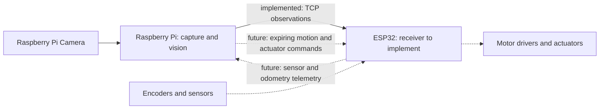

# Raspberry Pi / ESP32 architecture

The ROS 2 Humble `ppb_vision` graph implements camera capture/CameraInfo,
synchronized 2D/3D detections, health/watchdogs and a separate ROS-to-TCP
observation bridge. See [ROS setup](../camera/ROS2.md).
The camera capture/detection and observation sender exist. ESP32 reception,
sensor telemetry, motor commands and integrated control are **still to implement**.
TCP on a local IP network is the initial bench observation transport; validate
the final robot link before adopting it for control.



The Pi owns images and eventually localization/planning/strategy. ESP32 owns
sensor acquisition, drivers and deterministic local motor loops. Camera or network
timing must not set motor-loop timing. Stops and command expiry must work when
the Pi or link fails.

## Implemented observation protocol, version 1

`python3 -m camera.pi_vision --esp32-host ADDRESS` is a **TCP client**, connecting
to an ESP32/bench server on port 5000 by default. Messages are UTF-8 JSON followed
by one newline. TCP is a byte stream: buffer partial lines and handle multiple
lines in a read. Reset the partial-line buffer on each new connection. Maximum
message length is 65,536 bytes including the newline.

Example without calibration:

```json
{"v":1,"type":"vision","session":"example","seq":0,"read_monotonic_ns":123456789,"frame":"camera_optical","frame_ok":true,"calibrated":false,"image_size":[640,480],"detections":[{"id":1,"center_px":[319.5,239.5],"corners_px":[[270,190],[369,190],[369,289],[270,289]],"pose":null}]}
```

| Field | Meaning |
| --- | --- |
| `v`, `type` | Version 1, type `vision` |
| `session`, `seq` | Process ID and increasing observation number; new session after restart |
| `read_monotonic_ns` | Pi time just after frame retrieval; **not** exposure time or ESP32 time |
| `frame` | `camera_optical`: x right / y down / z forward |
| `frame_ok` | False invalidates old vision; true with empty detections means a valid image with no markers |
| `calibrated` | Intrinsics/common marker size supplied, not an accuracy/confidence guarantee |
| `image_size` | Width, height of processed frames |
| `detections` | Marker ID, pixel center/corners and optional pose |
| `pose` | Null or `{ "rvec_rad": [rx,ry,rz], "tvec_m": [x,y,z] }`; Rodrigues vector, not Euler angles |

The sender emits invalid/empty on orderly shutdown/error if possible. Link errors
drop unsent data and cause reconnects; there is no application replay queue.
TCP/kernel buffering can still delay data. `sendall` success is not receiver ACK.
No receive or acknowledgement path exists.

An ESP32 receiver should validate schema/version/length, track session/sequence,
clear on `frame_ok: false` and record receipt time on its own clock. Receipt-age
expiry alone cannot detect data already delayed in transit. Before closing a
control loop, add a measured clock/latency strategy or ACK/latest-observation
exchange with a tested maximum age. Pi/ESP32 monotonic clocks cannot be subtracted
directly. Do not interpret these observations as motor commands.

## Required next interfaces

| Interface | Needed behavior | Status |
| --- | --- | --- |
| Vision receiver | Bounded buffering, validation, latest observation and expiry | ESP32 firmware missing |
| Motion commands | Units/frame, session/sequence, validity duration, stop/disarm, ACK | Design pending |
| Actuator commands | New mechanism capabilities/limits and completion/fault feedback | Pending mechanism |
| Telemetry | Encoder ticks/odometry, ranges, switches, battery/faults, timestamps/validity | Pending sensors |
| Localization | Measured extrinsics, landmarks and odometry fusion | ROS references only |

AVR pins, WiFiEsp HTTP code, old gripper dimensions and PID gains are not an ESP32
specification. Keep board/pin/link choices in a hardware adapter. Check actual
I/O voltages and driver interfaces when choosing electronics. See
[electronics](../electronics/README.md) and [sensor control](<../ultrasonic sensor/README.md>).
